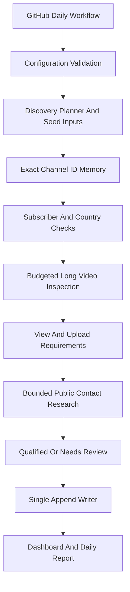

# USA YT Leads

Modular YouTube prospect research with an append-only Google Sheets ledger. Read **START_HERE.md** before running.

## Architecture

| Module | Responsibility |
|---|---|
| `src/config.py` | Settings, environment and validation |
| `src/discovery.py` | Query rotation, seeds and limited pagination |
| `src/youtube.py` | API client, pagination, request budgets and retries |
| `src/qualification.py` | Deterministic numerical filters and review reasons |
| `src/contacts.py` | Public HTML, evidence, team metadata, bounded website research |
| `src/models.py` | Headers, stable contact IDs and review delays |
| `src/sheets.py` | Header-aware persistence, formula IDs, append safety and snapshots |
| `src/reporting.py` | PKT run reports, dashboard and charts |
| `src/pipeline.py` | Checkpoints, rechecks and orchestration |

No mandatory AI API or custom channel score. Talking head confirmation is optional and disabled by default. English is a search preference, not an independently verified language claim. US means channel-declared country metadata; it is not independent proof of residence. Blank/unknown metadata routes to review.

## Safety boundaries

One repository workflow is the supported single writer. Its concurrency group does not lock other repositories. Do not give multiple copies concurrent write access to this spreadsheet. Row/header drift checks are fail-safe detection, not a distributed transaction.

The application uses one YouTube project and does not implement multi-project quota rotation. No API credentials or personal lead data are included in this source ZIP. The developer terms and project console remain the source of truth for your quota and permitted use.

## Pilot success criteria

1. Numeric fixtures: two high-view long videos qualify; Shorts never satisfy counts; three monthly long uploads are sufficient.
2. New contact appears only at the bottom, including a later address for a previously stored channel.
3. Repeat run does not duplicate a Channel ID/email combination within the same tab.
4. Different channel IDs never merge due to similar names.
5. Missing source evidence routes to review; generic contact publication never proves a person's inbox ownership.
6. Daily Report distinguishes new channels, old checks, published emails and row ranges.
7. Live pilot measures actual daily unique qualified channels. No 100-lead claim is made without evidence.

## Current limitations

No automatic video vision, unrestricted social crawling, deliverability verification, email sending, cross-repository locking, advanced identity entity resolution, or automatic old-workbook migration. Structured team metadata and explicit manually supplied sources can populate names; arbitrary team-page prose is not automatically interpreted. Contact research is deliberately bounded. Numerically suitable channels do not require visual approval. Missing country or unresolved contact evidence may still require review.

Automated compliance refresh/deletion for the entire historical ledger is not implemented. Operational contact refresh is capped and may fall behind. Do not treat historical rows as current verified data or deploy indefinitely without addressing retention obligations.

Official references:

- [YouTube Search API](https://developers.google.com/youtube/data/reference/rest/v3/search/list)
- [YouTube Developer Policies](https://developers.google.com/youtube/terms/developer-policies)
- [Google Sheets API](https://developers.google.com/workspace/sheets/api)

## Scrapling Runtime Integration

Scrapling is enabled in the automation. GitHub installs it from requirements.txt; no new secret is needed. See [INTEGRATIONS.md](INTEGRATIONS.md) for the active features, configuration, deployment and limitations. Daily Report includes Scrapling Pages and Scrapling Failures.

## Public JavaScript Pages

The automation now includes a bounded standard Chromium fallback for public website HTML that contains scripts but no extracted email. GitHub installs the browser and runs a real JavaScript/Scrapling smoke test before collection. See INTEGRATIONS.md for settings and limitations.
