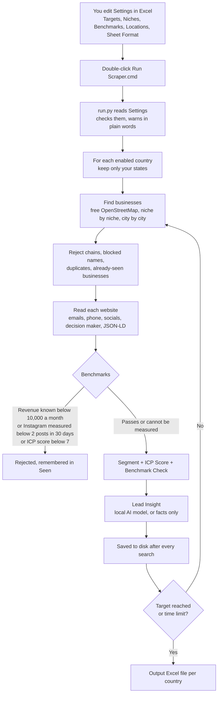

# Start Here: Offline Data Scraping

Finds local businesses that can pay US$500+ a month for social media services, on your own PC. No Google account, no GitHub, no paid key needed. It writes one Excel file per country with one Title Case tab per niche.

It is the Lead Bot Worldwide v6 engine (same benchmarks, same columns, same rules) with a local settings folder, a local AI option and crash protection added. Lead Bot Worldwide itself was not changed.

## 1. What You Get (End Result)

| Item | Where | What It Is |
|---|---|---|
| Leads | `Output\United States Leads.xlsx` (one file per country) | Tab `All Leads` plus one tab per niche. 75 columns: company, decision maker, emails, phone, socials, website, address, Lead Insight, Segment, ICP Score, Revenue Band, Benchmark Check |
| Run log | `Output\Run Log.txt` | What each run did, every warning and problem in plain words |
| Raw data | `app\data\<country code>\` | The engine's own files (append-only). Do not edit. This is the memory: what was already found and searched |
| Your controls | `Settings\` | Five CSV files you edit in Excel |

Format rules that are always applied: headers and tab names in Title Case, phone numbers without a plus sign (national format for the lead's own country), no email drafts, facts only (nothing guessed).

## 2. The Workflow



One "pass" is up to 20 minutes and 40 searches. The runner repeats passes until the country reaches `LEADS_TARGET_PER_COUNTRY`, the run reaches `MAX_HOURS_PER_RUN`, or two passes in a row find nothing new. Then it moves to the next country.

## 3. First-Time Setup

1. Open the folder `F:\Github Repos\projects\Offline Data Scraping`.
2. Double-click `install\INSTALL.cmd`. You should see `INSTALL OK` after a few minutes. (On this PC it is already installed and tested.)
3. Double-click `Pilot Test.cmd`. It collects about 8 leads in a few minutes. You should see `Run finished. Open the Output folder.`
4. Open `Output\United States Leads.xlsx` and check the rows look right.
5. Edit the files in `Settings\` (section 4), then double-click `Run Scraper.cmd` for the full run.

To stop a run: press `Ctrl+C` in the black window. Everything found so far is saved and the Excel file is still built.

From a terminal instead of double-clicking:

```bash
cd "F:\Github Repos\projects\Offline Data Scraping\app"
```

```bash
.venv\Scripts\python.exe run.py --pilot
```

```bash
.venv\Scripts\python.exe run.py
```

## 4. What You Can Change (All In `Settings\`, Open With Excel)

Save as CSV when Excel asks. Row 1 (the headers) must stay as it is. After any change, run `Pilot Test.cmd` first.

### Targets.csv: Countries And States
| Column | What To Type |
|---|---|
| Country | Compulsory. United States, Canada, United Kingdom, Australia, New Zealand, Ireland (also United Arab Emirates, Saudi Arabia, Qatar) |
| States | Blank or `All States` = whole country. Or names separated by `;` for example `Texas; Florida; NY`. Full names and short codes both work. A city name works too |
| Enabled | `Yes` to run it, `No` to skip it |

"Whole country" means every enabled city of that country in `Locations.csv`. If you name a US state that has no city in `Locations.csv`, its biggest city is searched automatically and the log tells you so.

### Niches.csv: Add, Remove, Switch On Or Off
- Switch off: put `No` in `Enabled`. Remove: delete the row (it stays off).
- Add: copy a similar row, change `Niche`, `Search Terms` and `Free Map Selectors`. Keep `Budget Low AUD` at 500 or more, or the niche is skipped.
- `Free Map Selectors` are OpenStreetMap tags, for example `amenity=restaurant; amenity=cafe` or `shop=beauty + name~lash|brow`. Look tags up at taginfo.openstreetmap.org.
- The ten threshold columns at the end (`Reviews Min` to `Review Rate`) can stay blank: the engine then uses its own value for each country.
- 28 niches from Lead Bot Worldwide plus 10 new ones (5 on, 5 off). Reasons and sources: `docs\Niche Research.md`.

### Benchmarks And Rules.csv: What Qualifies A Lead
| Setting | Now | Meaning |
|---|---|---|
| `MIN_MONTHLY_REVENUE` | 10000 | Known revenue below this = rejected. US$500 a month is 5% of US$120,000 a year (SBA 7-8%, Gartner 7.7%, CMO Survey 9% of revenue goes to marketing) |
| `MIN_POSTS_30D` | 2 | Your rule: measured Instagram posts in 30 days below this = rejected (Worldwide uses 1) |
| `PREFERRED_POSTS_30D` | 4 | Counts as "active" in Benchmark Check |
| `MIN_ICP_SCORE` | 7 | Leads scoring below this are rejected |
| `ONLY_EXPORT_PROVEN_INSTAGRAM_ACTIVE` | No | Yes = the Excel file keeps only leads with measured Instagram activity (needs a key, see section 6) |
| `LEADS_TARGET_PER_COUNTRY` | 100 | New leads per country per run |
| `MAX_HOURS_PER_RUN` | 4 | Time limit for the whole run |
| `LOCAL_LLM_MODEL`, `LOCAL_LLM_URL` | blank | Your local AI model (section 5) |
| `BLOCK_NAME_WORDS`, `BLOCK_NAME_WORDS_WORLD` | lists | Chains and franchises that are never added |
| `TIMEZONE` | Asia/Karachi | Date used in `Lead Added On` |

Every other row has its own explanation in the `What It Does` column.

### Locations.csv: Cities
One row per search area. Add a row with Country, State, City, Search Area, Enabled `Yes`, Priority 1-3 and Radius km. Latitude and Longitude can stay blank (looked up once, then remembered).

### Sheet Format.csv: Columns Of The Excel File
Row order = column order. `Show` = `No` hides a column. `Rename To` changes the header text. Deleting a row also hides that column.

## 5. Your Local AI Model (Optional)

Without it everything still works: `Lead Insight` is built from facts only.

1. Start your model server (Ollama or LM Studio). Ollama was not found on this PC's PATH when this was built.
2. Open `Settings\Benchmarks And Rules.csv`.
3. Put the model name in `LOCAL_LLM_MODEL`, for example `llama3.1:8b`.
4. Leave `LOCAL_LLM_URL` as `http://localhost:11434/v1` for Ollama, or use `http://localhost:1234/v1` for LM Studio.
5. Run `Pilot Test.cmd`. You should see `Local AI: on (your model)`. If the server is not running you see `Local AI: server not reachable` and the run continues with facts only.

Status: the connection code is written but NOT tested against a real model (none was available).

## 6. Honest Limits (Read This)

| Limit | Why | What To Do |
|---|---|---|
| Instagram "2 posts a month" cannot be measured for free | Instagram shows post dates only to logged-in or official API users | Add `IG_ACCESS_TOKEN` + `IG_USER_ID` (free, official) or `APIFY_API_TOKEN` to `secrets\.env`. Until then `Benchmark Check` shows `?` for activity and the lead is kept, not removed |
| Revenue is often `?` in free mode | Revenue is estimated only from Google review counts, and the free map has no reviews | Add `SERPER_API_KEY` or `GOOGLE_PLACES_API_KEY`. Without them the bot ranks by niche budget, website and contact quality instead |
| Fewer leads than Google Maps | OpenStreetMap lists fewer businesses and needs a website on the listing | Add more cities, or import a gosom Google Maps CSV into `app\imports\` (optional, breaks Google's terms, your choice) |
| Decision maker and personal email on roughly 20-35% of leads | Only what a website or public result prints is used | Hunter key raises it |
| 9 countries only | The engine has phone, currency and review rules for these | Ask for another country to be added |
| Email law | UK and Ireland (GDPR, PECR) and Canada (CASL) are strict | Prefer company addresses, keep an opt-out. Not legal advice |

## 7. Audit: Problems Found And Fixed In Advance

| # | Problem Found | Fix |
|---|---|---|
| 1 | Local mode saved its files only at the very end. A crash, power cut or closed window lost the whole run | Saves after every search |
| 2 | Files were written in place. A crash during saving could leave a half file | Written to a temp file, then swapped (atomic) |
| 3 | Only cloud AI keys were supported, no local model | Any OpenAI-compatible local server works (`local:<model>`) |
| 4 | The key checker would have thrown the local model away as "bad format" | New key shape registered |
| 5 | A niche or city you deleted was silently added back as enabled | Deleted items are added back as `No` |
| 6 | One crashed pass ended the run | Each pass is isolated: 3 retries with a 30 second wait, then the next country. Errors go to `Run Log.txt` |
| 7 | Two runs at once would overwrite each other | Lock file. The second run stops with a clear message |
| 8 | Excel file open while the run ends = crash | Saved as a new copy and the log says so |
| 9 | Excel saves CSV in two different encodings | Both are read |
| 10 | A named state with no city found nothing | US: biggest city is added. Other countries: a clear warning |
| 11 | Memory growth on long runs | Work is split into 20-minute passes; each pass starts clean |
| 12 | Control characters or `=` at the start of a cell can break or abuse Excel | Stripped on export |

Not fixed (flagged): some setting names still say `AUD` (`MIN_BUDGET_AUD`, `Budget Low AUD`). They are plain number thresholds; the names are kept so fixes can be copied between this app and Lead Bot Worldwide.

## 8. Recommendations

1. Add the free Instagram token first. It is the only way to enforce your "2 posts a month" rule.
2. Add a Serper or Google Places key second. It makes the revenue benchmark real for most leads.
3. Start with 2-3 states and the niches marked On, check the Excel file, then widen.
4. Run it daily at a fixed time with Windows Task Scheduler (section 9).
5. Keep `ONLY_EXPORT_PROVEN_INSTAGRAM_ACTIVE` on `No` until a key is in place.

## 9. Run It Automatically Every Day

1. Press the Windows key, type `Task Scheduler`, press Enter.
2. Click `Create Basic Task`. Name: `Offline Data Scraping`. Click Next.
3. Choose `Daily`, pick a time, click Next.
4. Choose `Start a program`. Program: `F:\Github Repos\projects\Offline Data Scraping\Run Scraper.cmd`. Add arguments: `--scheduled`. Click Next, then Finish.
5. You should see the task in the list. Right-click it and choose `Run` once to test.

## 10. Tools And Skills Used (GitHub)

| Tool | Used For | Safety Scan |
|---|---|---|
| python-phonenumbers | Phones without `+` | SAFE |
| tenacity | Retry with backoff | SAFE |
| extruct | JSON-LD and microdata on websites | SAFE |
| email-validator | Email syntax | SAFE |
| RapidFuzz, tldextract | Duplicate detection | SAFE |
| Scrapling | One retry when a site answers 403 | CAUTION (approved earlier) |
| openpyxl | Excel output (new here) | Not scanned yet: scan before trusting |
| gosom/google-maps-scraper | Optional Google Maps CSV import | CAUTION, not installed |
| instaloader | Instagram posts without a token | Not installed: unreliable, ban risk |

Scan reports: `F:\Github Repos\scans\`. Registry: `F:\Github Repos\SKILLS-REGISTRY.md`.

## 11. Troubleshooting

| You See | Meaning | Do This |
|---|---|---|
| `No country is enabled` | Every row in `Targets.csv` says No | Put `Yes` on one row |
| `row 1 must keep the original headers` | A header was changed | Delete that Settings file and run again: a fresh one is created |
| `Another run is already working` | A second window is open | Close the other window |
| `add Latitude/Longitude in Locations` | The city name could not be looked up | Type the coordinates in `Locations.csv` |
| `Stopped map searches after 3 failures` | The free map servers are busy | Run again later |
| `no leads yet` | Nothing passed the benchmarks | Read `Problems:` in the window; lower `MIN_ICP_SCORE` or add cities and niches |
| File named `... (New 2315).xlsx` | The Excel file was open | Close Excel next time |

## 12. Folder Map

| Path | What |
|---|---|
| `Start Here.md` | This guide |
| `Run Scraper.cmd`, `Pilot Test.cmd` | Double-click to run |
| `Settings\` | Your controls |
| `Output\` | Excel files and the run log |
| `app\run.py` | The runner (settings, passes, Excel) |
| `app\src\` | The Lead Bot Worldwide v6 engine with 4 small fixes |
| `app\data\` | Collected data and memory |
| `install\INSTALL.cmd` | One-click install (`-Check` to only test) |
| `secrets\` | Optional keys (`.env`), never shared |
| `docs\` | Niche research, sheet contract |
| `proof\` | Test output |

Moving to a new PC: copy the whole folder, install Python 3.12, run `install\INSTALL.cmd`.
